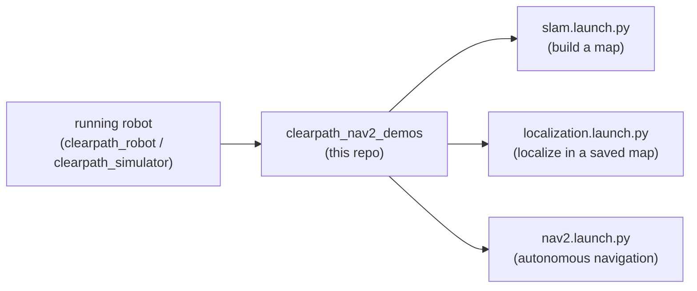

# clearpath_nav2_demos

Nav2 and slam_toolbox demos for clearpath platforms

Example [Nav2](https://docs.nav2.org/) and [slam_toolbox](https://github.com/SteveMacenski/slam_toolbox)
configurations and launch files showing how to run mapping, localization, and autonomous
navigation on Clearpath platforms.

For supported platforms, sensors, and manipulators plus additional details, please see:
<https://docs.clearpathrobotics.com/docs/ros/>

## Where this fits in the Clearpath ROS 2 stack

This is a **downstream demo** package. It assumes a robot is already running — either real
hardware (`clearpath_robot`) or simulation (`clearpath_simulator`) — publishing the standard
sensor topics and TF tree. It layers a navigation stack on top of that running robot.



## Layout

| Path | Description |
| --- | --- |
| [`launch/slam.launch.py`](launch/slam.launch.py) | Online SLAM with `slam_toolbox` to build a new map. |
| [`launch/localization.launch.py`](launch/localization.launch.py) | AMCL localization within an existing map. |
| [`launch/nav2.launch.py`](launch/nav2.launch.py) | The Nav2 navigation stack (planner, controller, behaviors). |
| [`config/`](config) | Per-platform parameter files (`a200`, `a300`, `dd100`, `dd150`, `do100`, `do150`, `j100`, `r100`, `w200`). |
| [`maps/`](maps) | Sample maps (e.g. `warehouse.pgm` / `warehouse.yaml`) matching the simulator worlds. |

## Usage

Start a robot or simulation first, then launch the desired demo. Parameters are selected per
platform via the `config/<platform>` directories. For example, to build a map:

```bash
ros2 launch clearpath_nav2_demos slam.launch.py
```

Then, to navigate within a saved map:

```bash
ros2 launch clearpath_nav2_demos localization.launch.py
ros2 launch clearpath_nav2_demos nav2.launch.py
```

See the [Clearpath navigation demos documentation](https://docs.clearpathrobotics.com/docs/ros/tutorials/navigation_demos/overview)
for the full, platform-specific walkthrough.

## Build

```bash
rosdep install --from-paths src --ignore-src -r -y
colcon build --symlink-install
source install/setup.bash
```

## Notes

- The demos do **not** start a robot; launch `clearpath_robot` or `clearpath_simulator` first.
- Pick the config that matches your platform. Mismatched footprints/sensor frames are a common
  cause of poor navigation behavior.

## Read saved Ridgeback power logs on another computer

The power logger saves ROS 2 MCAP bags on the Ridgeback under
`/home/robot/rosbags/power/session_*`, with approximately one-minute segments.
Run the following commands on the **Jetson or other destination computer**.
Replace the robot address, session name, and topic prefix as needed.

### List and copy recordings

List sessions, newest first, and list their segment files:

```bash
ssh robot@192.168.131.1 'ls -1dt ~/rosbags/power/session_*'
ssh robot@192.168.131.1 'ls -lh ~/rosbags/power/session_*/*.mcap'
```

Choose a completed session and copy its entire directory, including
`metadata.yaml` and all `.mcap` files:

```bash
mkdir -p ~/ridgeback_logs
scp -r robot@192.168.131.1:/home/robot/rosbags/power/session_REPLACE_ME ~/ridgeback_logs/
```

For a smaller transfer, copy one completed segment instead:

```bash
scp robot@192.168.131.1:/home/robot/rosbags/power/session_REPLACE_ME/SEGMENT_REPLACE_ME.mcap ~/ridgeback_logs/
```

The newest session may still be recording. Prefer an older session, or a segment
from the current session that has a newer segment after it. Avoid copying the
file currently being written; session metadata is finalized when recording ends.
Once copied, the files can be read without a connection to the robot.

### Prepare the destination computer

Use ROS 2 Jazzy with the rosbag tools, MCAP storage plugin, Fast DDS middleware,
and Clearpath platform message definitions. On Ubuntu with the ROS apt
repository configured, install missing packages:

```bash
sudo apt update
sudo apt install ros-jazzy-ros2bag ros-jazzy-rosbag2-transport \
  ros-jazzy-rosbag2-storage-mcap ros-jazzy-rmw-fastrtps-cpp \
  ros-jazzy-clearpath-platform-msgs
```

If using workspace-built Clearpath messages, source that workspace after the
base ROS setup instead. The message definitions must match the recorded type.

### Inspect and read the copied messages

In **both playback and echo terminals**, run this setup. It selects local Fast
DDS playback even if the Jetson normally uses the robot's Zenoh router, and
keeps replay in a separate domain restricted to this computer:

```bash
source /opt/ros/jazzy/setup.bash
export RMW_IMPLEMENTATION=rmw_fastrtps_cpp
export ROS_DOMAIN_ID=99
export ROS_AUTOMATIC_DISCOVERY_RANGE=LOCALHOST
unset ROS_STATIC_PEERS ROS_DISCOVERY_SERVER ROS_LOCALHOST_ONLY
unset FASTRTPS_DEFAULT_PROFILES_FILE FASTDDS_DEFAULT_PROFILES_FILE
```

Inspect a copied session to see its topics, message counts, and duration:

```bash
ros2 bag info ~/ridgeback_logs/session_REPLACE_ME
```

In **terminal 1**, start the reader before playback so it can receive the first
messages. Use the topic name shown by `ros2 bag info`:

```bash
ros2 topic echo /r100_0165/platform/mcu/status/power \
  clearpath_platform_msgs/msg/Power --qos-reliability best_effort
```

In **terminal 2**, replay the copied session:

```bash
ros2 bag play ~/ridgeback_logs/session_REPLACE_ME --delay 3
```

Messages appear as YAML in terminal 1. Playback ends at the end of the recording;
press Ctrl+C in terminal 1 to stop the reader. To inspect just one copied minute,
replace the session directory with its `.mcap` file in either `ros2 bag info` or
`ros2 bag play`:

```bash
ros2 bag info ~/ridgeback_logs/SEGMENT_REPLACE_ME.mcap
ros2 bag play ~/ridgeback_logs/SEGMENT_REPLACE_ME.mcap --delay 3
```

See the [rosbag2 documentation](https://github.com/ros2/rosbag2/tree/jazzy)
for playback options and the [Clearpath Power message definition](https://github.com/clearpathrobotics/clearpath_msgs/blob/jazzy/clearpath_platform_msgs/msg/Power.msg)
for field meanings.
